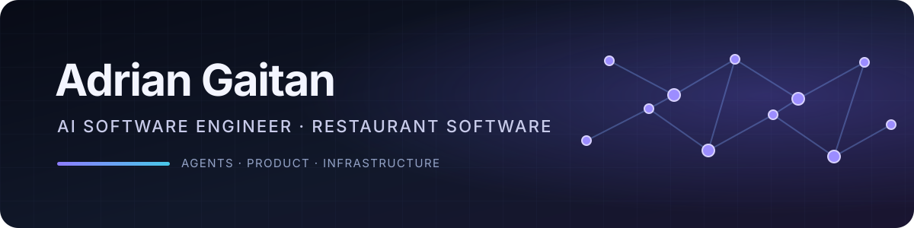
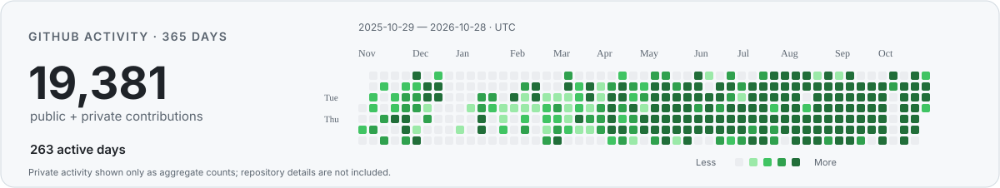

  

# Adrian Gaitan

**AI Software Engineer at KitchenSync · Remote**

I build and ship ambitious products through multi-agent orchestration, agentic development, and infrastructure at scale. At KitchenSync, I lead a team building software that helps restaurants run their back office. I focus on world-class product quality, fast delivery, and adapting as AI evolves.

  
  
  
  
  

## Current focus

I use AI agents both in the products we build and in my own engineering workflow. At KitchenSync, I lead a team shipping multi-agent and LLM workflows for restaurant operations, while staying hands-on across product delivery, engineering, and infrastructure.

## Engineering toolkit

**AI & agents**

  

**Product engineering**

    

**Cloud & infrastructure**

    

## Experience

### KitchenSync · AI Software Engineer · Remote · 2025–Present

Lead a team building software for restaurant back-office operations, including multi-agent orchestration and LLM-powered workflows.

### Reach My Leads · Full Stack Developer · Aug 2023–Nov 2025

Migrated a NestJS monolith to horizontally scalable AWS microservices with rolling deployments. Built event-driven systems with BullMQ, Redis, and WebSockets, including a call engine handling **10K+ calls/day** and a queue-based mass-messaging platform. Worked across product management, design, frontend, backend, and DevOps, and managed developers.

## Selected work

- **[Beela](https://dev.beela.app)** — AI-native operating system for Colombian small businesses, bringing scheduling, services, payments, customer messaging, and analytics together with multi-agent orchestration.
- **[Codex Permission Reviewer](https://github.com/adriancho91s/codex-permission-reviewer)** — local TypeScript MCP server and bundled Codex skill that gives an advisory second opinion on potentially damaging actions; it never executes actions or grants host permission.
- **[Agent Memory Layer](https://adriangaitan.dev/#projects)** — tree-structured distributed memory framework that gives AI coding agents structured context across sessions.

**More:** I founded [SwiftControl](https://swiftcontrol.co), a software company building developer tools and product infrastructure. I also co-directed a six-week [Full Stack bootcamp](https://elitestack-bootcamp.vercel.app) with faculty from Universidad Tecnológica de Pereira, designing curriculum and mentoring students.

## GitHub activity

<!-- github-activity-summary:start -->
**19,381 public + private contributions · 263 active days** 
*2025-10-29 – 2026-10-28 · UTC. Private activity is shown only as aggregate counts.*
<!-- github-activity-summary:end -->

  <picture>
    <source media="(prefers-color-scheme: dark)" srcset="./assets/github-activity-dark.svg">
    <source media="(prefers-color-scheme: light)" srcset="./assets/github-activity-light.svg">
    
  </picture>

This dated snapshot shows aggregate contribution counts only; no repository names or details are included. Refresh it locally with `node scripts/refresh-github-activity.mjs` after signing in through GitHub CLI.

### Public repository languages

  <a href="https://github.com/stats-organization/github-stats-extended">
    <picture>
      <source media="(prefers-color-scheme: dark)" srcset="https://github-stats-extended.vercel.app/api/top-langs/?username=adriancho91s&amp;layout=compact&amp;langs_count=6&amp;hide_border=true&amp;theme=dark_github">
      <source media="(prefers-color-scheme: light)" srcset="https://github-stats-extended.vercel.app/api/top-langs/?username=adriancho91s&amp;layout=compact&amp;langs_count=6&amp;hide_border=true&amp;theme=light_github">
      
    </picture>
  </a>

## Let's build something useful

For product engineering, agent orchestration, or infrastructure work, [email me](mailto:hello@adriangaitan.dev) or visit [adriangaitan.dev](https://adriangaitan.dev).
